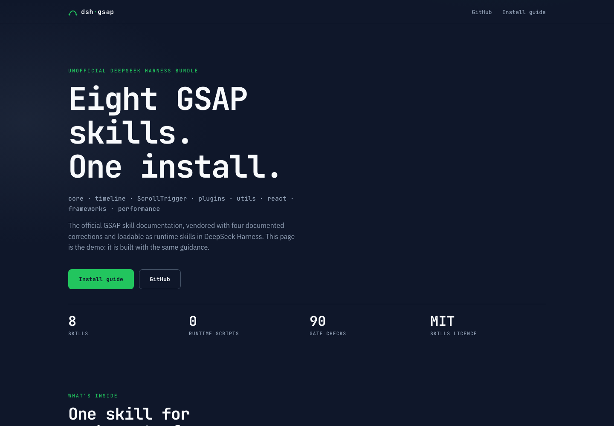

[English](README.md) · [繁體中文](README.zh-TW.md) · [简体中文](README.zh-CN.md)

> 本文件是英文版的翻译；英文版为准。

# GSAP Skills for DeepSeek Harness

**`@chonwai/dsh-gsap-skills`** 把 GSAP 官方 8 个
[skill](https://github.com/greensock/gsap-skills) 打包成 DeepSeek Harness（DSH）
bundle，并套用 **4 项已记录的事实更正**。每个 `SKILL.md` 都注册成 runtime
skill，所以 session 可以按需载入 `gsap-core`、`gsap-timeline`、
`gsap-scrolltrigger`、`gsap-plugins`、`gsap-utils`、`gsap-react`、
`gsap-frameworks` 和 `gsap-performance`。

这是独立的社群整合：与 GreenSock 或 GSAP 项目没有隶属、赞助或背书关系。
“GSAP”与“GreenSock”是 GreenSock, Inc. 的商标。skill 文档采用 MIT 授权；
**GSAP 库本身没有随附，也不是 MIT**——请在你的项目里按 GreenSock 自己的条款
安装 GSAP。

**Scope 规则（先读这条）：** 本 bundle 注册在 host/global skill layer。Web app
把 `skill-filesystem` 挂在 agent preset 的 scope 里，并停用 host 层的
filesystem row；因此 `~/.agents/skills`、`$DSH_HOME/skills` 或项目
`.agents/skills` 底下这些 skill 的任何文件层副本，都位于**更近的 preset
layer**，会直接赢得同名 skill——**bundle 无法覆盖它**。要让 bundle 生效，必须
把文件层副本移出 skills root；见下方《从文件层安装迁移》。只要这类副本还在，
profile 已安装就不等于 catalog 的胜出条目是 bundle。

## 快速开始

在 **Plugins → Add plugin → Install a third-party plugin** 里贴上
`https://github.com/Chonwai/dsh-gsap-skills#v1.0.8`，按 **Enable now**，然后
**重启 DSH**、打开一个 session，载入 `/gsap-core`。其他通道（release
tarball、agent／`plugin_manager`、未来的 npm）、验证方式、layer 迁移与疑难排解：
[docs/DISTRIBUTION.zh-CN.md](docs/DISTRIBUTION.zh-CN.md)。

## 演示

[`demo/`](demo/) 是一个自包含的交互页面，用本 bundle 自己的 skill 指引写成：
hero 进场 timeline、随滚动揭示的 skill 卡片，以及一条 pinned、随滚动 scrub 的
Timeline → ScrollTrigger → Plugins 横向条，并带有 reduced-motion 与无 CDN 时的
fallback。在 repo 根目录跑 `python3 -m http.server 8000`，打开 `/demo/`；页面
从 pinned CDN 载入 GSAP 3.15.1，所以需要网络。



## 这个 bundle 提供什么

| Skill | 用途 |
|---|---|
| `gsap-core` | `gsap.to/from/fromTo`、easing、duration、stagger、defaults、`matchMedia` |
| `gsap-timeline` | 编排顺序、position parameter、嵌套、播放控制 |
| `gsap-scrolltrigger` | 滚动连动的动画、pin、scrub、trigger |
| `gsap-plugins` | 注册、Flip、Draggable、ScrollSmoother、SplitText、SVG、ease |
| `gsap-utils` | `clamp`、`mapRange`、`normalize`、`interpolate`、`random`、`snap`、`wrap`、`pipe` |
| `gsap-react` | `useGSAP`、refs、`gsap.context()`、cleanup |
| `gsap-frameworks` | Vue、Nuxt、Svelte、SvelteKit 的生命周期与清理 |
| `gsap-performance` | transform、layout thrashing、`will-change`、batching |

另外随附 `skills/llms.txt`（上游的 skill 索引）。Host half 会把 8 个 skill
全部注册，`resourceBase` 指向各自的 skill 目录。没有 client half，没有
settings/Config schema，没有 prompt 区段，没有 telemetry，没有 runtime 依赖，
也没有联网／开进程／写文件的权限——模块只读自己套件内的文件。

## 更正了什么

由 `tools/apply-corrections.mjs` 在 vendor 时套用；每一项替换都连同上游 issue
或源码证据引用在 [docs/KNOWN-UPSTREAM-ISSUES.md](docs/KNOWN-UPSTREAM-ISSUES.md)：

1. **`gsap-core` transform 顺序**——文档写的别名顺序是
   `translation → scale → rotationX/Y → skew → rotation`，这是错的；GSAP 3.15.1
   的 CSSPlugin 实际组合成 `translation → rotation → rotationY → rotationX →
   skew → scale`。
2. **`gsap-timeline` position parameter**——删除了错误的“(default)”标记；省略
   position parameter 是附加在 timeline 末端，而 `">"` 的意思是“最近加入的
   动画之后”。
3. **`gsap-scrolltrigger` refreshPriority**——方向写反了；**数字越大越先
   refresh**，所以页面上的第一个 section 要拿较大的数字。
4. **`gsap-frameworks` 重复的 `type Plugins`**——第二个声明改名为
   `type PluginName = keyof PluginMap`，并同步更新 `PluginModule`、
   `PluginExport` 和 `lazyLoadPlugin`。

有记录但没有修补的：GSAP 3.15 的 `easeReverse` 在这些 skill 里没有提到；Nuxt
示例把 cleanup 写在 `onMounted`（issue #23），该示例没有随附。两者都记录在
known-issues 文件里。Fail-loud 的 vendor 脚本会盯住每一个预期字符串，上游若
修正了任何预期字符串，脚本就会中止，因此更正不会悄悄失效。

## 需求

- DeepSeek Harness **0.2.2-rc.1**（`engines.dsh: ">=0.2.2-rc.1 <0.3.0"`）。
- Node.js **>= 22**（沿用 Harness 的要求）。
- 受管理的 DSH profile（Desktop app 的 `desktop` profile，或由 CLI 管理的
  profile）。
- **GSAP 本身没有随附。** 这些 skill 只记录怎么用 GSAP；每个用户的项目要按
  GreenSock 的授权，自行从 npm 安装 `gsap`（以及需要的 plugin）。

## 安装

三种方式都写在 [INSTALL.zh-CN.md](INSTALL.zh-CN.md)：

1. **Plugins 页（建议）**：Plugins → Add plugin → 安装第三方 plugin → 粘贴
   这个目录的绝对路径。
2. **`plugin_manager` 工具**：
   `plugin_manager(action: "install_bundle", target: "/abs/path/to/dsh-gsap-skills")`。
3. **手动复制（进阶，只在 Plugin Manager 不可用时）**：把 checkout 复制到
   profile 的 `node_modules`，再手动加进 profile 的 dependency 与 bundle 清单；
   INSTALL.zh-CN.md 有完整步骤与回滚方式。

**安装或切换 bundle 后要重启 DSH。** Profile bundle rows 是在 DSH host 开机时
compose 的；新建 session 或重载页面都不会重新 compose，`plugin_manager` 显示
installed/enabled 只代表 profile 状态正确，不代表运行中的 host 已经挂载这个
row。

## 使用方式

在 session 里用 `skill` 工具或它的 `/` 手势载入：

- `/gsap-core`——“这个元素要怎么用 GSAP 做动画？”
- `/gsap-timeline`——“把这些步骤串成 timeline，`"<"` 是什么意思？”
- `/gsap-scrolltrigger`——“pin 住这个 section，并用 scrub 播放动画”
- `/gsap-plugins`——“注册 SplitText，并 lazy-load Draggable”
- `/gsap-react`——“在 React 里清掉这个动画”
- `/gsap-frameworks`——“Vue/Nuxt/Svelte 的生命周期清理”
- `/gsap-performance`——“这个列表动画会卡，为什么？”
- `/gsap-utils`——“用 gsap.utils 做 clamp 与 snap”

自然语言也可以：“用 GSAP timeline 这个 skill 帮我看一下这段序列”。Skill 正文
是上游文档，不会安装套件，也不会执行任何动画代码。

## 从文件层安装迁移（bundle 要生效的必要步骤）

DSH 源码里的三个事实，决定了哪一份 skill 会胜出：

1. `@deepseek-ai/dsh-web-app/presets/standard.patch.yml` 把
   `skill-filesystem` 挂在 **agent preset 的 scope 里**。
2. `@deepseek-ai/dsh-web-app/cordis.patch.yml` **停用 host 层的
   `skill-filesystem` row**（注解明写 "presets own local discovery"）。
3. `@deepseek-ai/dsh-skill` 把 global layer 与观看 scope 的 chain 合并：
   **最近一层的同名条目直接胜出**；rank 只在同一层内排序重名条目。

本 bundle 是 host row，所以注册在 **global layer**。任何位于
`~/.agents/skills`、`$DSH_HOME/skills` 或项目 `.agents/skills` 的 `gsap-*`
文件层副本，都会被 preset 的 provider 扫到，因此位于**更近的 scoped layer**，
无条件胜出；bundle 无法覆盖它。预检：

```bash
for d in ~/.agents/skills "${DSH_HOME:-$HOME/.dsh}/skills"; do
  for s in gsap-core gsap-timeline gsap-scrolltrigger gsap-plugins gsap-utils gsap-react gsap-frameworks gsap-performance; do
    test -d "$d/$s" && echo "WARNING: file-level copy will shadow the bundle: $d/$s"
  done
done
```

把副本移出去（本套件不会替你搬）：

```bash
mkdir -p ~/.dsh-backup
for s in gsap-core gsap-timeline gsap-scrolltrigger gsap-plugins gsap-utils gsap-react gsap-frameworks gsap-performance; do
  test -d ~/.agents/skills/$s && mv ~/.agents/skills/$s ~/.dsh-backup/$s-$(date +%F)
  test -d "${DSH_HOME:-$HOME/.dsh}/skills/$s" && mv "${DSH_HOME:-$HOME/.dsh}/skills/$s" ~/.dsh-backup/$s-dsh-$(date +%F)
done
```

项目内的 `<repo>/.agents/skills/gsap-*` 副本也必须一并移出。移除动作会由
filesystem watcher 在下一个 pre-step 接手（移除本身不需要重启）；但安装或切换
bundle 本身仍然需要重启 DSH。

## 已验证与未验证

以下每一项都可以在套件目录里直接执行。**已在 macOS 27.2（arm64）、Node
22.21.1、2026-11-09 验证**：

| 检查 | 命令 | 结果 |
|---|---|---|
| Offline 闸门 | `bash tests/offline-check.sh` | `RESULT: PASS (90 checks)` |
| Host smoke | `node tests/host-smoke.mjs` | `11/11 passed` |
| Registry smoke（可选） | `node tests/registry-smoke.mjs`，用 `DSH_ASAR_MODULES` 指向解包后的 `app.asar` 中的 `@deepseek-ai` | `3/3 passed` |
| 更正检查 | `node tools/apply-corrections.mjs --check` | `corrections: 10/10 verified` |
| JS 语法 | `node --check lib/index.js` | exit 0 |
| Vendor 幂等性 | 重跑 `tools/vendor-upstream.sh --from-dir /tmp/gsap-skills --ref aed9cfd3… --no-tests` | `skills/`、`checksums.txt`、`provenance.json` byte-identical |

没有解开的 DSH 套件树时，可选的 registry 测试会打印 `SKIP` 并 exit 0；**SKIP
不算验证，只有真正的 `PASS` 才算。**

**未验证：**

- **其他机器上的 live 启用。** 维护者机器上的 bundle 已安装并生效：
  `skill("gsap-core")` 由已安装的套件载入，磁盘上的版本跟随最新 release。新
  机器安装后可能需要重启。请在你自己的机器上验证——载入后的 `Base directory`
  必须指向套件，而不是 `~/.agents`。
- **Plugins 页面的呈现**：本地化标题／描述与 icon 的实际显示。
- **GSAP runtime 行为。** 这些更正是对照 GSAP 3.15.1 源码（以及上游 issue）
  验证的，不是把每个动画放进浏览器实际跑过；套件没有随附 GSAP 库。
- **上游是否已修。** issue #20/#21/#23 在 2026-11-09 时仍是 open；随附的更正
  属于本 bundle，不是上游的。
- **非 macOS 主机**，以及 0.2.2-rc.1 以外的 DSH 版本。
- **没有 npm 发布**：只能从 checkout 安装（`private: true`）。

## 上游已知问题

完整引述、源码证据与 issue 链接：
[docs/KNOWN-UPSTREAM-ISSUES.md](docs/KNOWN-UPSTREAM-ISSUES.md)。
系列惯例：[docs/SERIES.md](docs/SERIES.md)。

## 开发

```bash
npm test                  # offline gate; prints RESULT: PASS
npm run check             # node --check lib/, tests/, tools/
npm run smoke             # host + optional registry + demo browser smoke
npm run smoke:demo        # headless Chrome demo smoke (SKIP if no Chrome)
npm run prompt-contract   # deterministic static contract on demo/
npm run corrections-check # verify the four corrections in the vendored tree
```

`smoke:demo` 需要本机有 Chrome/Chromium，以及能连到 pinned CDN 的网络；找不到
Chrome 时会打印 `SKIP` 并 exit 0——**SKIP 不算验证**。CI 的 `ubuntu-latest`
runner 内建 Chrome，会真正执行 demo smoke。`prompt-contract` 是确定性的静态
检查，不需要浏览器；六个 prompt contract 与检查规则见
[`demo/PROMPTS.md`](demo/PROMPTS.md)。

重新 vendor（确定性、幂等）：

```bash
bash tools/vendor-upstream.sh aed9cfd3277740755f6bfc1155c7aa645403b760 \
  --repo /path/to/gsap-skills
# or from an existing checkout:
bash tools/vendor-upstream.sh --from-dir /path/to/gsap-skills \
  --ref aed9cfd3277740755f6bfc1155c7aa645403b760
```

它会复制 8 个 `SKILL.md` 与 `llms.txt`、套用更正（预期原文消失就失败）、重写
`checksums.txt` 与 `provenance.json`，并跑各道闸门。若 commit 变更，记得更新
[NOTICE](NOTICE) 的 `Source:` 行：`NOTICE` 与 `provenance.json.ref` 不一致时
offline 闸门会失败。没有 build 步骤。

## 目录结构

```
lib/index.js                 host half: read, parse, register, dispose
cordis.patch.yml             one insert row: id gsap -> @chonwai/dsh-gsap-skills
skills/gsap-*/SKILL.md       the eight vendored skills (four corrections applied)
skills/llms.txt              upstream skill index
locale/{en,zh}.json          plugin-page title/description/detail
icon.svg                     original motion/timeline glyph
checksums.txt                sha256 pins for the nine vendored files
provenance.json              upstream URL, full commit, four corrections
tools/vendor-upstream.sh     re-vendor + correct + checksums + provenance + tests
tools/apply-corrections.mjs  the fail-loud four-correction script
docs/KNOWN-UPSTREAM-ISSUES.md  quotes, corrections, issue links, documented gaps
docs/SERIES.md               series naming and verification conventions
patches/README.md            why corrections are code, not diff files
tests/offline-check.sh       static acceptance gate
tests/host-smoke.mjs         fake-Cordis mount test
tests/registry-smoke.mjs     optional real dsh-skill registry test
```

## 授权与署名

MIT，见 [LICENSE](LICENSE)。8 个 skill 文件与 `llms.txt` vendor 自
[greensock/gsap-skills](https://github.com/greensock/gsap-skills) 的
`aed9cfd3…`（MIT，Copyright (c) 2026 GreenSock），并套用上述 4 项更正。
[NOTICE](NOTICE) 包含上游 MIT 全文、商标／无隶属声明、修改声明，以及
“GSAP 库未随附、也不是 MIT”的明确说明。Icon 是本 bundle 的原创作品。
